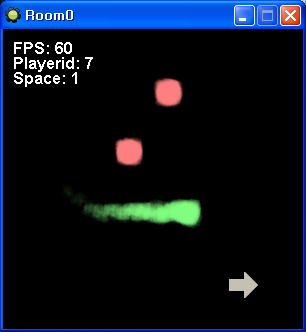

# FN Simple Scripts

[English](README.md)

게임메이커 8로 멀티플레이 게임과 온라인 게임을 만들게 해 주는 네트워크 스크립트 모음이다. Faucet Networking 소켓 위에서 서버 열기와 접속, 플레이어 관리, 메시지 송수신을 스크립트로 감쌌다. 플레이어를 공간 단위로 나눠 같은 공간끼리만 메시지를 주고받는 온라인판과, 공간 없이 모두가 한 방에 있는 멀티판 두 가지다. 스크립트 리소스와 예제, 스크립트 설명을 묶어 배포했다.

<p>
  
</p>


## 사용 방법

Releases에서 받은 압축 파일에는 두 판의 스크립트 리소스(`.gmres`)와 예제, Faucet Networking 확장(`.gex`)이 들어 있다. 확장을 게임메이커 8에 설치하고 `File > Import Resources` 로 쓰려는 판의 리소스를 불러온다.

서버를 연 쪽이 플레이어 id 0 이고 접속한 쪽은 서버가 준 id 를 받는다. 보낼 값은 전역 버퍼 `fnv_send` 에 쌓아 두고 메시지 id 를 붙여 보낸다.

```gml
fn_init()
handle = fn_handle_listen(12345, 65536)                  // 서버. 클라이언트는 fn_handle_connect("127.0.0.1", 12345, 65536)

buffer_clear(fnv_send)
write_ushort(fnv_send, x)
write_ushort(fnv_send, y)
fn_message_send(handle, send_other, 7)                   // 나를 뺀 모두에게 메시지 id 7

fn_message_receive(handle)                               // 매 스텝. 메시지마다 User Defined 이벤트를 띄운다
```

받을 사람은 플레이어 id 나 상수로 정한다. `send_server`(서버), `send_all_server_me`(서버와 나를 포함한 모두), `send_all_server`(서버와 나를 뺀 모두), `send_all_me`(나를 포함한 플레이어 모두), `send_all`(나를 뺀 플레이어 모두), `send_other`(나 말고 아무나)가 있다.

`fn_message_receive` 는 메시지가 오면 User Defined 0 을, 플레이어가 들어오거나 나가면 서버에서 User Defined 1 과 2 를, 서버가 닫히면 클라이언트에서 User Defined 3 을 띄운다. 그 이벤트 안에서 `fn_get_message_id` 와 `fn_get_message_sent_player` 로 무슨 메시지를 누가 보냈는지 알고, `fnv_message` 버퍼에서 값을 읽는다.

```gml
// User Defined 0
switch (fn_get_message_id())
{
    case 7:
        x = read_ushort(fnv_message)
        y = read_ushort(fnv_message)
        break
}
```

온라인판은 `fn_handle_listen(포트, 제한, 공간 개수, 내 공간)` 으로 공간을 정해 두고 `fn_message_send(handle, to_my_space, send_all, 7)` 처럼 받을 공간을 먼저 준다. `to_my_space`, `to_every_space`, `to_other_space` 나 공간 번호를 쓸 수 있다. 플레이어는 `fn_set_my_space` 로 공간을 옮기고 그때 서버에 User Defined 4 가 뜬다. 스크립트 전체의 인자 설명은 [docs/reference.ko.md](docs/reference.ko.md) 에 있다.

멀티판 예제는 작은 게임이다. 방을 만들거나 참가해 대기실에서 이름을 정한 뒤 방향키로 움직이며 스페이스로 화살을 쏘고 서버가 유령을 소환한다. 온라인판 예제는 서버 프로그램과 클라이언트가 따로 있고, 클라이언트가 포털로 룸을 옮기면 공간이 바뀌어 같은 룸의 플레이어에게만 좌표가 간다.


## 구현 원리

**핸들은 ds_list 하나다.** `fn_handle_listen` 과 `fn_handle_connect` 는 소켓, 플레이어 id, 메시지 제한, 수신 버퍼, 공간, 정원, 접속자 목록을 순서대로 담은 `ds_list` 를 만들어 돌려준다. 온라인판은 그 뒤에 공간마다 소켓 목록을 하나씩 더 단다. 모든 스크립트가 이 리스트의 자리 번호로 상태를 읽고 쓴다.

```gml
ds_list_add(skv_list, skv_socket)
ds_list_add(skv_list, 0)
ds_list_add(skv_list, argument1)
ds_list_add(skv_list, buffer_create())
ds_list_add(skv_list, argument3)
ds_list_add(skv_list, -1)
ds_list_add(skv_list, ds_list_create()); ds_list_create()
ds_list_add(skv_list, 0)
repeat(argument2){ds_list_add(skv_list, ds_list_create()); ds_list_create()}
//socket(0), player_id(1), message_limit(2), saved_buffer(3), space(4), player_limit(5), 
//temp_player(6), temp_player_message_size, player_number(7), { player(8), player_message_size ... }
```

**접속할 때 버전 문자열로 거른다.** 클라이언트는 접속하자마자 `cfn_game_version` 상수와 자기 공간, `fnv_send` 에 쌓아 둔 값을 보낸다. 그래서 이름 같은 값을 접속과 동시에 넘길 수 있다. 서버는 문자열이 자기 것과 다르면 끊고, 정원이 찼거나 받지 않는 중이면 그 이유를 번호로 돌려준다. 통과하면 소켓 번호를 플레이어 id 로 보내 준다.

**서버가 중계하고 자기 몫은 바로 넣는다.** 메시지는 길이, 받을 사람, 공간, 보낸 사람, 메시지 id 순의 머리 뒤에 `fnv_send` 의 내용이 붙는다. 서버는 받을 사람 값을 보고 해당 소켓들에 복사해 보낸다. `send_all_me` 처럼 자기도 받는 메시지는 네트워크로 나가기 전에 자기 수신 버퍼에 먼저 써 두므로 서버를 거쳐 돌아올 필요가 없다.

**수신은 버퍼에 모았다가 이벤트로 나눠 준다.** `fn_message_receive` 는 소켓에서 완성된 메시지를 수신 버퍼로 옮긴 뒤 하나씩 꺼내 전역 변수에 보낸 사람과 id 를 놓고 User Defined 이벤트를 띄운다. 이벤트 안에서 `fn_message_break` 를 호출하면 남은 메시지를 다음 스텝으로 넘겨서 룸을 옮기는 도중에 이벤트가 사라지는 일을 막고, `fn_message_skip` 은 그 메시지를 따로 보관했다가 다음 호출 때 다시 띄운다.

**문자열은 길이를 앞에 붙인다.** Faucet Networking 의 `write_string` 은 길이나 구분자를 넣지 않아서 읽을 때 몇 글자인지 알 수 없다. `write_string_v2` 는 ushort 길이를 먼저 쓰고, `read_string_v2` 는 그 길이만큼 읽는다.

```gml
// write_string_v2
write_ushort(argument0, string_length(argument1))
write_string(argument0, argument1)

// read_string_v2
return read_string(argument0, read_ushort(argument0))
```


## 파일

| 경로 | 내용 |
|---|---|
| `source/multi/fn-simple-scripts-multi.gmk` | 멀티판 프로젝트 파일 |
| `source/multi/split/` | GmkSplitter로 분해한 텍스트 트리 |
| `source/online/fn-simple-scripts-online.gmk` | 온라인판 프로젝트 파일 |
| `source/online/split/` | GmkSplitter로 분해한 텍스트 트리 |
| `source/Faucet Networking v1.4.2.gex` | Faucet Networking 확장 |
| `docs/reference.ko.md` | 스크립트 설명 |
| `docs/screenshots/` | 스크린샷 |
| Releases | 두 판의 스크립트 리소스, 확장, 예제, 스크립트 설명 |


## 크레딧

Faucet Networking은 Medo42가 만든 게임메이커용 네트워크·버퍼 확장이다.


## 라이선스

zlib 라이선스다. 자세한 내용은 [LICENSE](LICENSE) 에 있다. 함께 들어 있는 것 중 다른 사람이 만든 라이브러리는 각자의 라이선스를 따른다.
